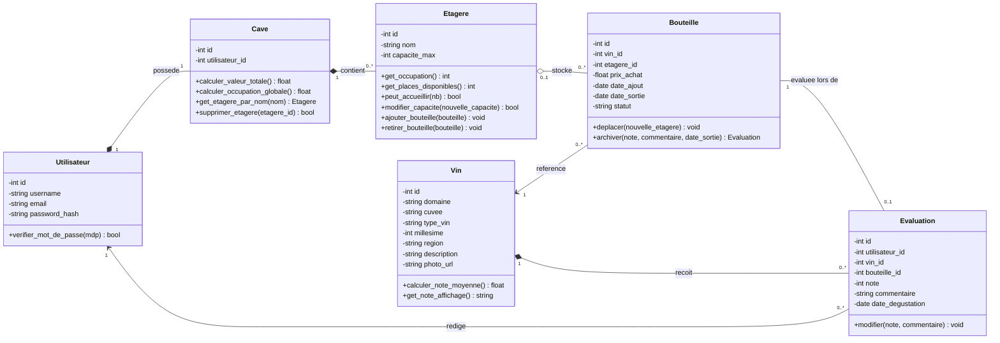
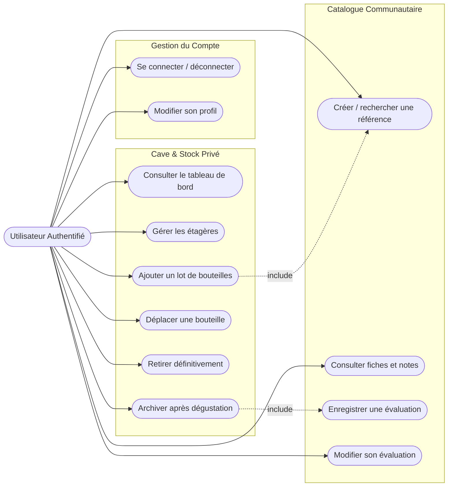
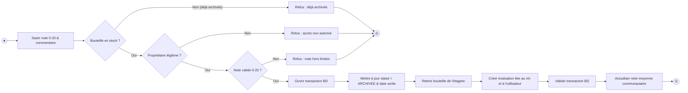
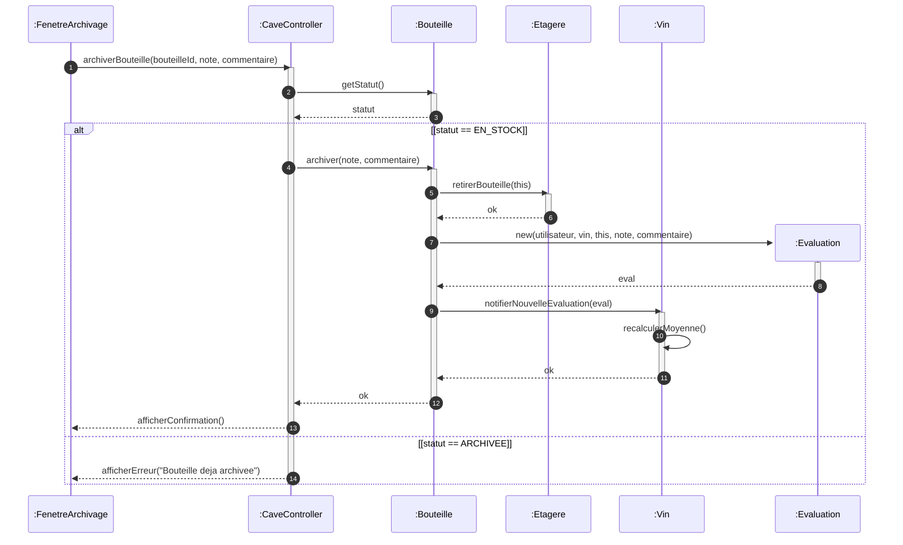

# MaCave — Gestion collaborative d'une cave à vin

Application web multi-utilisateurs développée en Python (Flask) et SQLite permettant aux amateurs de vin de gérer leur stock privé de bouteilles, d'organiser leurs étagères et de partager leurs évaluations au sein d'une communauté[cite: 1, 5].

Projet réalisé dans le cadre de l'UE **ETRS711** (Conception et Programmation Orientée Objet)[cite: 1].

---

## Sommaire

1. [Fonctionnalités principales](#fonctionnalités-principales)
2. [🆕 Interface Web Enrichie - Inventaire et Notation](#-interface-web-enrichie---inventaire-et-notation)
3. [Architecture du dépôt et organisation du code](#architecture-du-dépôt-et-organisation-du-code)
4. [Modèle relationnel et règles de gestion](#modèle-relationnel-et-règles-de-gestion)
5. [Persistance des données et cycle de vie](#persistance-des-données-et-cycle-de-vie)
6. [Diagrammes UML (Mermaid)](#diagrammes-uml-mermaid)
7. [Installation et lancement avec uv](#installation-et-lancement-avec-uv)
8. [Qualité de code (Ruff) et Tests automatisés (pytest)](#qualité-de-code-ruff-et-tests-automatisés-pytest)
9. [Jeu de démonstration](#jeu-de-démonstration)
10. [Limites et perspectives](#limites-et-perspectives)

---

## Fonctionnalités principales

* **Comptes et sécurité :** Inscription, authentification par session Flask, hachage sécurisé des mots de passe (`werkzeug.security`) et contrôles d'accès stricts côté serveur (isolation totale des caves privées)[cite: 2].
* **Gestion de cave & étagères :** Création, modification et suppression contrôlée d'étagères (capacité max, taux d'occupation, interdiction de suppression si non vide)[cite: 2].
* **Gestion du stock (Bouteilles) :**
  * Distinction formelle entre une **référence de vin** (partagée au catalogue) et les **exemplaires physiques** (bouteilles privées)[cite: 3].
  * Ajout par lot d'exemplaires avec garantie d'atomicité (tout ou rien)[cite: 3].
  * Déplacement de bouteilles entre étagères sous contrainte de capacité[cite: 3].
  * Retrait définitif du stock ou archivage après dégustation[cite: 3, 4].
* **Communauté & Évaluations :**
  * Enregistrement de notes (0 à 20) et commentaires lors de l'archivage[cite: 4].
  * Calcul dynamique de la note moyenne communautaire (affichage explicite « Non évalué » si aucune note)[cite: 4].
  * Modification restreinte à l'auteur de l'évaluation[cite: 4].
* **Tableau de bord personnel :** Nombre de bouteilles, nombre de références distinctes, occupation globale et valeur totale financière du stock (avec gestion explicite sans étagère pour éviter la division par zéro)[cite: 4].
* **🆕 Interface web enrichie :**
  * **Inventaire visuel** avec cartes de vins, photos et filtres (recherche, type, région).
  * **Fiches de vins détaillées** avec notes communautaires en évidence et toutes les évaluations.
  * **Système de notation complet** : saisie de notes 0-20, commentaires de dégustation, modification de ses propres évaluations.
  * **Catalogue amélioré** avec affichage des notes moyennes et nombre d'évaluations.

---

## 🆕 Interface Web Enrichie - Inventaire et Notation

Une nouvelle interface web complète a été ajoutée pour faciliter la gestion de votre inventaire et le système de notation communautaire :

### Page d'Inventaire (`/inventaire/`)
* **Vue en cartes** avec photos des vins (quand disponibles)
* **Filtres intelligents** : recherche par nom, filtre par type de vin, filtre par région
* **Regroupement par vin** : toutes vos bouteilles d'un même vin sont regroupées
* **Notes moyennes** affichées directement sur chaque carte
* **Actions rapides** : archiver une bouteille avec évaluation depuis l'inventaire

### Fiche de Détail d'un Vin (`/inventaire/vin/<id>`)
* **Note communautaire en évidence** avec nombre d'évaluations
* **Liste de vos bouteilles** avec statut (en stock / archivées)
* **Toutes les évaluations** de la communauté avec commentaires
* **Votre évaluation personnelle** modifiable
* **Actions** : déplacer une bouteille, archiver avec dégustation

### Catalogue Amélioré (`/catalogue/vins`)
* **Affichage en cartes** avec photos
* **Notes moyennes** et nombre d'évaluations pour chaque vin
* **Accès rapide** aux fiches détaillées

### Système de Notation
* **Notes de 0 à 20** avec commentaires de dégustation
* **Moyenne communautaire** calculée dynamiquement
* **Modification** de ses propres évaluations uniquement
* **Respect des règles métier** : R9 (moyenne arithmétique), R10 (affichage "Non évalué"), R12 (modification par l'auteur uniquement)

Pour plus de détails, consultez `MaCave/NOUVELLES_FONCTIONNALITES.md`.

---

## Architecture du dépôt et organisation du code

Le projet est hébergé dans le répertoire `MaCave` et s'appuie sur le layout standard `src/` géré par `uv`[cite: 5, 6] :

```text
ETRS711_MaCave/
├── README.md              # Présentation générale du dépôt
└── MaCave/                # Racine du projet Python
    ├── README.md          # Documentation technique détaillée
    ├── pyproject.toml     # Métadonnées, dépendances et configuration (uv, ruff, pytest)
    ├── uv.lock            # Verrouillage reproductible des versions
    ├── schema.sql         # Schéma relationnel SQLite avec contraintes d'intégrité
    ├── init_db.py         # Script d'initialisation de la base locale
    ├── seed.py            # Jeu de démonstration multi-comptes
    ├── src/
    │   └── macave/
    │       ├── __init__.py    # Factory de l'application Flask (create_app)
    │       ├── app.py         # Point d'entrée exécutable local
    │       ├── db.py          # Gestion du cycle de vie SQLite (g.db)
    │       ├── models/        # Entités POO métier
    │       │   ├── __init__.py
    │       │   ├── bouteille.py
    │       │   ├── cave.py
    │       │   ├── etagere.py
    │       │   ├── evaluation.py
    │       │   ├── utilisateur.py
    │       │   └── vin.py
    │       ├── services/      # Logique métier et transactions (hors HTTP)
    │       │   ├── __init__.py
    │       │   ├── auth_service.py
    │       │   └── stock_service.py
    │       ├── routes/        # Contrôleurs web Flask (blueprints)
    │       │   ├── __init__.py
    │       │   ├── auth_routes.py
    │       │   ├── catalogue_routes.py
    │       │   ├── cave_routes.py
    │       │   └── inventaire_routes.py  # 🆕 Routes d'inventaire et notation
    │       ├── static/        # Feuilles de style CSS et images
    │       └── templates/     # Vues HTML Jinja2
    │           ├── base.html
    │           ├── auth/
    │           ├── cave/
    │           ├── catalogue/
    │           └── inventaire/  # 🆕 Templates d'inventaire
    └── tests/                 # Tests unitaires et d'intégration
        ├── __init__.py
        ├── conftest.py        # Fixtures pytest (base SQLite :memory:)
        └── test_metier.py     # Couverture des scénarios R1 à R12
```

---

## Modèle relationnel et règles de gestion

* **R1 (Confidentialité) :** Le stock, les étagères, les prix d'achat et les dates d'entrée sont privés[cite: 2]. Le catalogue de vins et les avis de dégustation sont partagés[cite: 2].
* **R2 & R3 (Étagères) :** Les noms d'étagères sont uniques au sein d'une cave[cite: 2]. L'occupation ne dépasse jamais la capacité maximale[cite: 2].
* **R4 & R5 (Intégrité des étagères) :** La capacité est incompressible sous l'occupation actuelle[cite: 2]. Une étagère contenant des bouteilles ne peut pas être supprimée[cite: 2].
* **R6 & R7 (Stock & Atomicité) :** L'ajout de plusieurs exemplaires ou le déplacement de bouteilles est transactionnel (tout réussit ou rien n'est modifié)[cite: 2, 3].
* **R8 (Cycle de vie) :** Une bouteille archivée libère son emplacement sur l'étagère et passe dans l'historique[cite: 4]. Impossible d'archiver ou de retirer une bouteille déjà archivée[cite: 4].
* **R9 à R12 (Évaluations) :** Moyenne arithmétique calculée uniquement sur les dégustations enregistrées[cite: 4]. Chaque dégustation a le même poids[cite: 4]. Seul l'auteur peut modifier son évaluation[cite: 4].

---

## Persistance des données et cycle de vie

* **Fichier SQLite local :** La base est stockée dans `MaCave/macave.db`[cite: 5]. Les données sont écrites directement sur disque et persistent après extinction (`Ctrl+C`) et relance de l'application[cite: 6].
* **Idempotence :** Le schéma s'appuie sur `CREATE TABLE IF NOT EXISTS` pour éviter d'altérer les enregistrements existants au redémarrage.
* **Clés étrangères :** L'activation explicite de `PRAGMA foreign_keys = ON;` assure le contrôle référentiel côté SQLite[cite: 5].
* **Environnement de test isolé :** La suite de tests tourne sur une base éphémère en mémoire vive (`:memory:`), évitant tout impact sur la base de développement.

---

## Diagrammes UML (Mermaid)

### 1. Diagramme de classes métier



### 2. Diagramme de cas d'utilisation



### 3. Diagramme d'activité : Archivage d'une bouteille



### 4. Diagramme de séquence — Archivage et Évaluation



---

## Installation et lancement avec uv

### Prérequis
* Python 3.10+
* `uv` installé (`curl -LsSf https://astral.sh/uv/install.sh | sh` ou via Homebrew)
* Git

### 1. Se positionner dans le répertoire du projet et synchroniser

```bash
cd MaCave

# Crée l'environnement virtuel local et installe les dépendances
uv sync
```

### 2. Initialiser la base de données SQLite

```bash
uv run python init_db.py
```

### 3. Charger le jeu de données de démonstration

```bash
uv run python seed.py
```

### 4. Lancer l'application web

```bash
uv run python src/macave/app.py
```
Accéder ensuite à l'interface dans le navigateur : `http://127.0.0.1:5000`

---

## Qualité de code (Ruff) et Tests automatisés (pytest)

Les commandes s'exécutent depuis le dossier `MaCave/` :

### 1. Linting et formatage avec Ruff

```bash
# Vérification du code
uv run ruff check .

# Application des corrections automatiques
uv run ruff check --fix .

# Formatage selon les conventions PEP 8
uv run ruff format .
```

### 2. Tests automatisés avec pytest

La suite de tests vérifie l'ensemble des règles métier exigées par le sujet[cite: 6] :
* Capacité max et atomicité de l'ajout par lot (R3, R7)[cite: 2, 3, 6].
* Déplacement de bouteille et mise à jour des étagères (R7)[cite: 3, 6].
* Retrait d'un exemplaire laissant le reste intact (R6)[cite: 3, 6].
* Archivage avec évaluation et interdiction de ré-archivage (R8)[cite: 4, 6].
* Calcul exact de la note moyenne et mention « Non évalué » (R9, R10)[cite: 4, 6].
* Isolation stricte des données privées entre utilisateurs (R1)[cite: 2, 6].

Exécuter les tests en mode verbeux :

```bash
uv run pytest -v
```

Exécuter les tests avec rapport de couverture :

```bash
uv run pytest -v --cov=macave
```

---

## Jeu de démonstration

Le script `seed.py` initialise automatiquement deux comptes pour vérifier le comportement multi-utilisateurs[cite: 6] :

| Utilisateur | Identifiant | Mot de passe | Données de départ |
| :--- | :--- | :--- | :--- |
| **Alice** | `alice` | `password123` | Étagères « Bordeaux » (cap. 10) et « Bourgogne » (cap. 6), 5 bouteilles en stock, 1 bouteille archivée (note 16/20)[cite: 6]. |
| **Bob** | `bob` | `password123` | Étagère « Cave Principale » (cap. 12), exemplaires du même vin qu'Alice avec évaluation (note 14/20)[cite: 6]. |

* **Moyenne partagée :** Sur la référence *Château Montelena*, la note communautaire affiche `15.0 / 20`[cite: 3, 4, 6].
* **Isolation :** Connecté en tant que Bob, le stock et les étagères d'Alice restent inaccessibles par navigation ou accès direct d'URL[cite: 2, 6].

---

## Limites et perspectives

* **Photos des étiquettes :** Gérées par URL externe pour ne pas alourdir le dépôt Git.
* **✅ Interface enrichie :** Inventaire visuel avec filtres et système de notation complet maintenant implémentés.
* **Perspectives :** 
  * Export CSV/PDF de l'inventaire personnel
  * Filtres avancés par accords mets-vins
  * Statistiques personnelles de dégustation
  * Comparaison de vos notes avec la moyenne communautaire